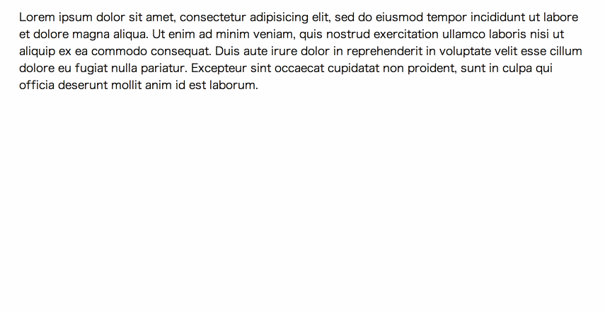

# Markless

> [!NOTE]
> This project is archived because I no longer actively use it, and there seems to be no recent activity from other users either. If you are still using it and would like to take over maintenance, please contact me somewhere.

Markless is a WYSIWYG editor library, which supports Markdown key-binding ([Demo](http://r7kamura.github.io/markless/)).



```js
new Markless({ selector: '#editor' }).run();
```
